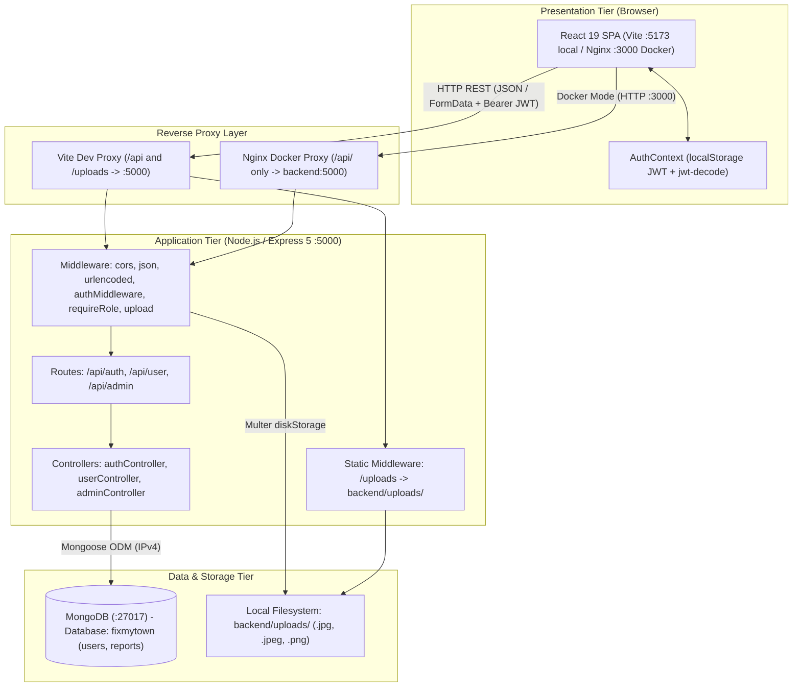
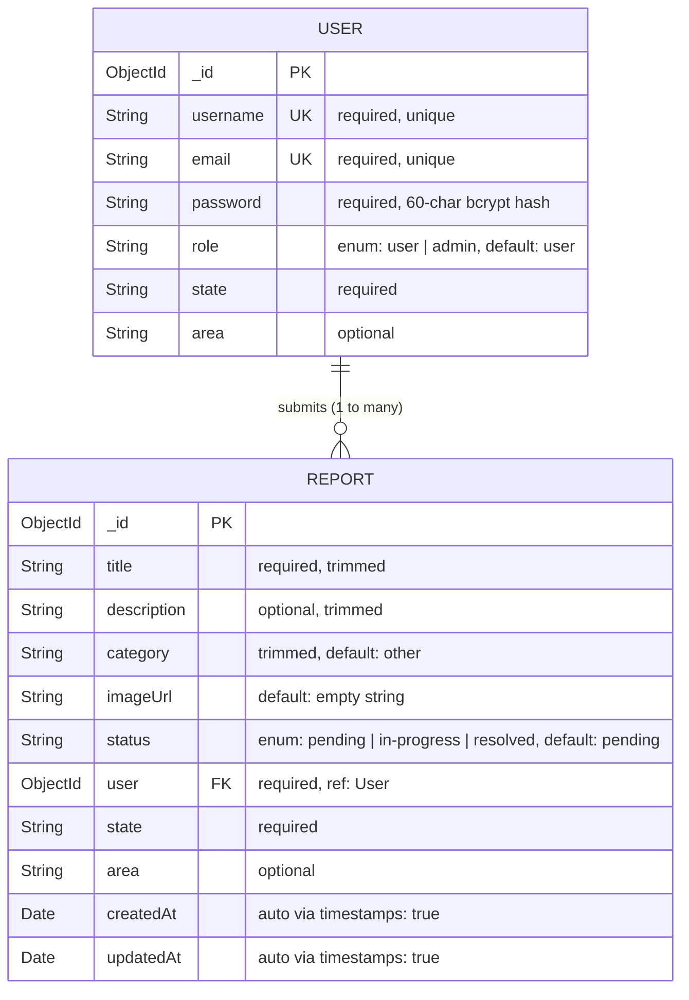
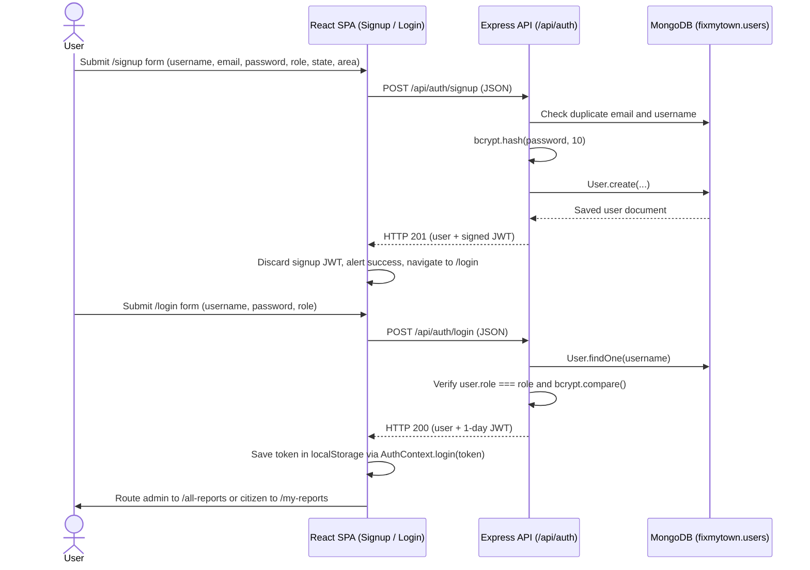
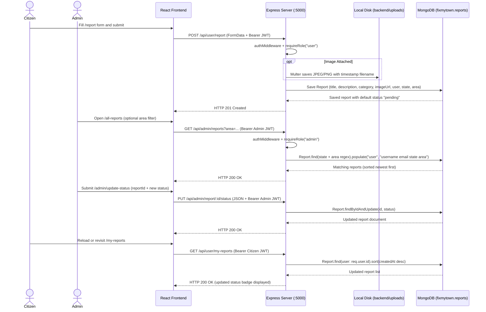

# JanSamasya – Final Technical Documentation

> **Project Name:** JanSamasya – A Civic Issue Reporting and Tracking Platform  
> **Tagline:** *"Report. Track. Resolve. Build a Better Community."*  
> **Architecture:** Decoupled 3-Tier MERN Stack (MongoDB, Express.js, React.js, Node.js)  
> **Documentation Standard:** Verified line-by-line against actual repository source code (`c:\Users\Calpeda\Music\CityCare-main`)  

---

## Table of Contents

1. [Project Provenance & Adaptation Attribution](#1-project-provenance--adaptation-attribution)
2. [Project Overview](#2-project-overview)
3. [System Architecture](#3-system-architecture)
4. [Project Folder Structure](#4-project-folder-structure)
5. [Frontend Architecture & Analysis](#5-frontend-architecture--analysis)
6. [Backend Architecture & Analysis](#6-backend-architecture--analysis)
7. [Database Architecture & Schema Analysis](#7-database-architecture--schema-analysis)
8. [Authentication & Authorization Implementation](#8-authentication--authorization-implementation)
9. [Feature Verification Matrix](#9-feature-verification-matrix)
10. [Complete REST API Reference](#10-complete-rest-api-reference)
11. [End-to-End Data Flows](#11-end-to-end-data-flows)
12. [File & Image Storage Analysis](#12-file--image-storage-analysis)
13. [Setup, Execution & Deployment Guide](#13-setup-execution--deployment-guide)
14. [Known Bugs, Limitations & Security Weaknesses](#14-known-bugs-limitations--security-weaknesses)
15. [Future Scope & Recommended Roadmap](#15-future-scope--recommended-roadmap)

---

## 1. Project Provenance & Adaptation Attribution

**JanSamasya** is adapted and rebranded from the existing open-source **CityCare** MERN repository (originally developed by Shivam Sharma, IIIT Ranchi, as credited in `frontend/src/pages/Home.jsx`).

To maintain full academic and technical transparency, reused components are explicitly distinguished from modifications made during debugging and rebranding:

- **Preserved from Original CityCare Repository:**
  - Core MERN project structure (`frontend/` and `backend/` directories).
  - Express route layout, Mongoose models (`User`, `Report`), JWT/Bcrypt authentication flow, Multer upload middleware, and React/Tailwind page layouts.
  - Dockerization scaffolding (`docker-compose.yml`, `backend/Dockerfile`, `frontend/Dockerfile`, `frontend/nginx.conf`).
  - Existing sample media files committed inside `backend/uploads/` (11 `.jpg`/`.jpeg` files).
  - MongoDB database name (`fixmytown`) and default ports (`5000`, `5173`, `27017`).

- **Debugging & Rebranding Changes Applied to This Repository:**
  - Rebranded user-visible application titles, navbar, login/signup headers, dashboard banners, footers, package metadata, Docker container names, and README files from **CityCare** to **JanSamasya**.
  - Fixed critical runtime/build defects found in the original repository: upgraded incompatible `postcss` (`^7` → `^8.4.49`) and `autoprefixer` (`^9` → `^10.4.20`) dependencies, converted `tailwind.config.js` to ES module syntax (`export default`) with a valid recursive content glob (`./src/**/*.{js,ts,jsx,tsx}`), added `category` to `Report.js`, fixed the double `/admin/admin/dashboard-stats` route prefix (retaining the legacy path as an alias), added `express.urlencoded` and safe `req.body || {}` guards, made `upload.js` resolve absolute paths reliably, added `/uploads` proxy in `vite.config.js`, and cleared ESLint errors.

No reused code from the original CityCare codebase is claimed as independently authored from scratch.

---

## 2. Project Overview

### 2.1 Purpose
**JanSamasya** is a full-stack civic issue reporting and grievance tracking web application. It enables citizens to register, submit local municipal issues (such as damaged roads, broken streetlights, waste dumping, or drainage problems) with optional photo attachments, and check the status of their submitted reports. Municipal administrators can view reports filtered by state and area, inspect global aggregate counts, and update report statuses through three lifecycle stages (`pending`, `in-progress`, `resolved`).

### 2.2 Core Problems Addressed
1. **Centralized Issue Logging:** Replaces informal or manual complaint channels with structured digital records containing titles, categories, descriptions, timestamps, and optional photos.
2. **State & Area Tagging:** Captures each user's state and optional district/area at registration and attaches those attributes to submitted reports for administrative filtering.
3. **Transparent Lifecycle Tracking:** Persists report progress across `pending`, `in-progress`, and `resolved` states in MongoDB so citizens can check status updates on demand.

### 2.3 Technology Stack (Verified Against `package.json` & Host Environment)

| Layer | Technology | Verified Version / Source | Role |
| :--- | :--- | :--- | :--- |
| **Frontend UI** | React & React DOM | `^19.1.0` (`frontend/package.json`) | Component-based SPA rendering |
| **Build Tool / Dev Server** | Vite | `^6.3.5` (`frontend/package.json`) | ESM bundling, HMR dev server, local API/uploads proxy |
| **Styling** | Tailwind CSS | `^3.4.17` (`frontend/package.json`) | Utility-first CSS framework |
| **CSS Pipeline** | PostCSS & Autoprefixer | `^8.4.49` / `^10.4.20` (`frontend/package.json`) | CSS compilation and vendor prefixing |
| **Routing** | React Router DOM | `^6.30.1` (`frontend/package.json`) | Client-side route matching |
| **HTTP Client** | Axios | `^1.13.6` (`frontend/package.json`) | Asynchronous REST API calls |
| **Token Decoding** | `jwt-decode` | `^4.0.0` (`frontend/package.json`) | Client-side JWT payload decoding in `AuthContext.jsx` |
| **Icons** | `lucide-react` | `^0.516.0` (`frontend/package.json`) | SVG icon components |
| **Code Linting** | ESLint + React Hooks/Refresh plugins | `^9.25.0` (`frontend/package.json`) | Static JavaScript/JSX linting |
| **Backend Runtime** | Node.js | `v18+` (Docker uses `node:18`; verified locally on `v24.20.0`) | Server-side JavaScript runtime |
| **Backend Framework** | Express.js | `^5.1.0` (`backend/package.json`) | HTTP routing, middleware pipeline, static file serving |
| **Database** | MongoDB Community Server | Tested locally on `v8.2.3`; Docker uses unpinned `mongo` | Document-oriented NoSQL database |
| **ODM** | Mongoose | `^8.16.0` (`backend/package.json`) | Schema validation, ObjectId relations, queries |
| **Authentication** | `jsonwebtoken` | `^9.0.2` (`backend/package.json`) | Stateless HMAC-SHA256 JWT issuance and verification |
| **Password Hashing** | `bcryptjs` | `^3.0.2` (`backend/package.json`) | Salted password hashing (10 rounds) |
| **File Uploads** | Multer | `^2.0.1` (`backend/package.json`) | Multipart form-data parsing and local disk storage |
| **CORS** | `cors` | `^2.8.5` (`backend/package.json`) | Cross-Origin Resource Sharing middleware |
| **Env Loading** | `dotenv` | `^16.5.0` (`backend/package.json`) | Loads environment variables from `backend/.env` |
| **Containers & Proxy** | Docker Compose & Nginx | `nginx:alpine` (frontend prod stage) | Multi-container packaging and `/api/` reverse proxy |

---

## 3. System Architecture

JanSamasya implements a decoupled 3-tier client-server architecture communicating over standard request-response HTTP REST APIs (no WebSockets, SSE, or background polling).



---

## 4. Project Folder Structure

```text
CityCare-main/
├── docker-compose.yml                        # Orchestrates MongoDB, backend, and frontend containers
├── README.md                                 # Root setup and feature overview
├── JANSAAMASYA_PROJECT_SEGMENTATION.md       # Initial architectural segmentation report
├── JANSAAMASYA_DOCUMENTATION_VERIFICATION.md # Read-only audit report verifying claims against code
├── JANSAAMASYA_FINAL_TECHNICAL_DOCUMENTATION.md # This verified final technical specification
├── backend/
│   ├── .dockerignore                         # Excludes node_modules and env files from Docker context
│   ├── .env                                  # Local environment variables (not committed)
│   ├── Dockerfile                            # Node 18 (Debian) backend container definition
│   ├── package.json                          # Backend dependencies and start script
│   ├── package-lock.json                     # Locked dependency versions
│   ├── server.js                             # Express app setup, CORS, routes, MongoDB connection loop
│   ├── controllers/
│   │   ├── adminController.js                # Admin report list, global stats, status update, delete
│   │   ├── authController.js                 # Signup, bcrypt hash, login, JWT signing
│   │   └── userController.js                 # Profile (from JWT), create/list/update/delete user reports
│   ├── middleware/
│   │   ├── authMiddleware.js                 # JWT verification (authMiddleware) and RBAC (requireRole)
│   │   └── upload.js                         # Multer diskStorage engine and JPEG/PNG regex filter
│   ├── models/
│   │   ├── Report.js                         # Mongoose Report schema with timestamps
│   │   └── User.js                           # Mongoose User schema (no timestamps)
│   ├── routes/
│   │   ├── adminRoutes.js                    # /api/admin/* endpoints (5 route definitions)
│   │   ├── authRoutes.js                     # /api/auth/* endpoints (3 route definitions)
│   │   └── userRoutes.js                     # /api/user/* endpoints (5 route definitions)
│   └── uploads/                              # Local disk storage containing 11 pre-existing sample images
└── frontend/
    ├── Dockerfile                            # Multi-stage build: node:18 builder -> nginx:alpine server
    ├── eslint.config.js                      # ESLint flat config (JS, React Hooks, React Refresh)
    ├── index.html                            # HTML shell with UTF-8 charset and JanSamasya title
    ├── nginx.conf                            # Nginx SPA fallback + /api/ proxy (no /uploads/ proxy)
    ├── package.json                          # Frontend dependencies and Vite/ESLint scripts
    ├── package-lock.json                     # Locked frontend dependencies
    ├── postcss.config.js                     # PostCSS 8 pipeline (tailwindcss + autoprefixer)
    ├── README.md                             # Frontend documentation
    ├── tailwind.config.js                    # ES module Tailwind config scanning ./index.html and ./src/**
    ├── vercel.json                           # Empty placeholder file (0 bytes; no rules configured)
    ├── vite.config.js                        # React plugin + local dev proxy for /api and /uploads
    ├── public/
    │   └── vite.svg                          # Browser favicon
    └── src/
        ├── App.css                           # Unused Vite starter stylesheet (not imported in App.jsx)
        ├── App.jsx                           # BrowserRouter, Navbar, and 9 unguarded Routes
        ├── index.css                         # Tailwind directives + 2 unused classes (.nav-link, .mobile-link)
        ├── main.jsx                          # Mounts StrictMode -> AuthProvider -> App into #root
        ├── assets/
        │   └── react.svg                     # Unused Vite template asset
        ├── components/
        │   └── Navbar.jsx                    # Sticky top navbar with conditional links and logout
        ├── context/
        │   └── AuthContext.jsx               # Global auth state, localStorage persistence, storage sync
        └── pages/
            ├── AdminDashboard.jsx            # Global report KPI cards + static System Health panel
            ├── AllReports.jsx                # State-scoped admin report list with live area input filter
            ├── Home.jsx                      # Public landing page (redirects any logged-in user to /profile)
            ├── Login.jsx                     # Role-aware login form
            ├── MyReports.jsx                 # Citizen report history and personal status counters
            ├── Report.jsx                    # Citizen issue submission form with optional file input
            ├── Signup.jsx                    # Citizen/Admin registration form with 28 Indian states
            ├── UpdateReportStatus.jsx        # Admin form to update report status by Report ID
            └── UserProfile.jsx               # Citizen profile summary + static Account Verified card
```

---

## 5. Frontend Architecture & Analysis

### 5.1 Bootstrap & Routing
- **`frontend/src/main.jsx`** mounts `<React.StrictMode><AuthProvider><App /></AuthProvider></React.StrictMode>` into `#root` (`frontend/index.html`).
- **`frontend/src/App.jsx`** renders `<Navbar />` persistently above `<Routes>` containing 9 routes:

| Path | Component | Intended Audience | Actual Frontend Route Guard |
| :--- | :--- | :--- | :--- |
| `/` | `Home` | Unauthenticated visitors | Redirects **any** logged-in `user` (including admins) to `/profile` |
| `/signup` | `Signup` | Public | None |
| `/login` | `Login` | Public | None |
| `/report` | `Report` | Citizen (`user`) | **None** (accessible via URL; API rejects unauthorized calls) |
| `/my-reports` | `MyReports` | Citizen (`user`) | **None** (accessible via URL; API rejects unauthorized calls) |
| `/profile` | `UserProfile` | Citizen (`user`) | **None** (admins redirected here from `/` hit `403 Forbidden`) |
| `/admin-dashboard` | `AdminDashboard` | Administrator (`admin`) | **None** (accessible via URL; API rejects unauthorized calls) |
| `/all-reports` | `AllReports` | Administrator (`admin`) | **None** (accessible via URL; API rejects unauthorized calls) |
| `/admin/update-status` | `UpdateReportStatus` | Administrator (`admin`) | **None** (accessible via URL; API rejects unauthorized calls) |

> **Note on Navigation:** Several internal page buttons in `MyReports.jsx`, `AllReports.jsx`, `UpdateReportStatus.jsx`, and `AdminDashboard.jsx` use standard HTML `<a href="...">` tags rather than React Router `<Link to="...">`, causing full browser page reloads instead of SPA transitions.

### 5.2 Global Authentication State (`AuthContext.jsx`)
- Synchronously initializes `token` and `user` from `localStorage.getItem("token")` using `jwtDecode(token)`.
- Exposes `{ user, token, login, logout }` to all child components via React Context.
- Subscribes to `window.addEventListener("storage", ...)` to keep login/logout state synchronized across multiple open tabs.
- **Limitation:** Does **not** validate the JWT `exp` (expiration) timestamp on initialization. An expired token remains in UI state until a backend request returns `HTTP 401`.

### 5.3 Page-by-Page Behavior & Static vs. Dynamic Distinction

| Component | Dynamic Backend Interaction | Static / Non-Functional UI Elements (Must Not Be Confused With Backend Features) |
| :--- | :--- | :--- |
| **`Navbar.jsx`** | Reads `user` from `AuthContext`; hides/shows Citizen vs. Admin links; triggers `logout()` + navigate `/login`. | Mobile hamburger `<button>` (lines 134–148) has **no `onClick` handler** and no drawer state. |
| **`Home.jsx`** | None (redirects to `/profile` if `user` exists). | "Quick Stats" (`12,547` reported, `9,832` resolved, `45,231` users, `78%` rate) are **hardcoded mock numbers**; `"View Live Issues"` button and 4 category cards have **no `onClick` handlers**. |
| **`Signup.jsx`** | `POST /api/auth/signup` with `{ username, email, password, role, state, area }`. Ignores the returned JWT and navigates to `/login`. | Helper text `"Minimum 6 characters recommended"` is advisory only (not enforced). |
| **`Login.jsx`** | `POST /api/auth/login` with `{ username, password, role }`. Calls `login(token)`, manually parses payload via `atob()`, and routes `admin` → `/all-reports` and `user` → `/my-reports`. | None. |
| **`Report.jsx`** | `POST /api/user/report` sending `FormData` (`title`, `description`, `category`, optional `image`) with `Authorization: Bearer <token>`. | "Platform Stats" card (`24-48 hrs`, `78%`, `12,547`) is **hardcoded**; `"Minimum 20 characters"` and `"Max 10MB"` labels are **not enforced** in code. |
| **`MyReports.jsx`** | `GET /api/user/my-reports` once on mount. Computes personal counters client-side from returned array and renders report cards. | No Edit or Delete buttons wired to the existing backend `PUT`/`DELETE` endpoints. |
| **`UserProfile.jsx`** | `GET /api/user/profile` once on mount. Displays `username`, `role`, `state`, and `area` returned from JWT claims. | `"Account Verified"` card is **hardcoded static JSX** (no verification flag exists). Conditional `email` and `createdAt` cards **never render** because the backend does not return those fields. |
| **`AdminDashboard.jsx`** | `GET /api/admin/dashboard-stats` once on mount. Displays global `total`, `pending`, `inProgress`, `resolved` counts and computes resolution percentage. | `"System Health"` (`ONLINE`, `CONNECTED`, `SECURED`) is **hardcoded static JSX**; `"Last Updated"` displays `new Date().toLocaleTimeString()` at render time. |
| **`AllReports.jsx`** | `GET /api/admin/reports` (with optional `?area=` param) on mount and on every keystroke of the area filter (un-debounced). | No Delete button wired to `DELETE /api/admin/report/:id`. |
| **`UpdateReportStatus.jsx`** | `PUT /api/admin/report/:id/status` with `{ status }` (`pending`, `in-progress`, or `resolved`). | Confirmation message says `"Citizens will be notified"` — **no notification system exists**. Dynamic Tailwind classes (`bg-${option.color}-50`, etc.) are not safelisted. |

### 5.4 API Communication & Local Proxying
All React pages invoke relative `/api/...` paths through Axios. In local development, `frontend/vite.config.js` proxies both `/api` and `/uploads` to `http://localhost:5000` with `changeOrigin: true` and `secure: false`.

---

## 6. Backend Architecture & Analysis

### 6.1 Express Server (`backend/server.js`)
1. Loads `.env` via `dotenv` and provides fallback defaults for `PORT`, `MONGO_URI`, and `JWT_SECRET` if environment variables are unset.
2. Applies `cors()` with a custom `origin` callback checking known Vercel domains (`https://city-care-chi.vercel.app`, `https://jansamasya-chi.vercel.app`, `https://jansamasya.vercel.app`) and localhost/127.0.0.1 regexes — **however, line 29 falls through to `return callback(null, true)`, effectively allowing all origins** (see Section 14).
3. Parses request bodies with `express.json()` and `express.urlencoded({ extended: true })`.
4. Serves uploaded media statically via `app.use("/uploads", express.static(path.join(__dirname, "uploads")))`.
5. Mounts modular routers at `/api/auth`, `/api/user`, and `/api/admin`.
6. Registers a 4-argument Express global error handler returning `HTTP 500` (`{ message: "Something went wrong!" }`).
7. Connects to MongoDB via `connectDB()` using `{ serverSelectionTimeoutMS: 5000, family: 4 }` and retries every 5 seconds on failure; starts `app.listen(PORT)` only after MongoDB connects.

### 6.2 Middleware
- **`backend/middleware/authMiddleware.js`:**
  - `authMiddleware`: Reads `req.headers.authorization`, validates `Bearer <token>` format, verifies signature and expiry with `jwt.verify(token, process.env.JWT_SECRET)`, and attaches decoded claims to `req.user`. Rejects missing/invalid/expired tokens with `HTTP 401`.
  - `requireRole(role)`: Checks `req.user.role !== role` and returns `HTTP 403` (`Access denied: Insufficient role`) on mismatch.
- **`backend/middleware/upload.js`:**
  - Ensures `backend/uploads/` exists via `fs.mkdirSync(..., { recursive: true })`.
  - Uses `multer.diskStorage` naming files `Date.now() + path.extname(file.originalname)`.
  - Filters uploads via regex `/jpeg|jpg|png/` tested against both extension and MIME type.
  - **No `limits.fileSize` cap is configured.**

### 6.3 Controllers
- **`authController.js`:**
  - `signup`: Validates `username`, `email`, `password`, `role`, `state` (`area` optional); rejects duplicate `email` or `username` with `HTTP 409`; hashes password with `bcrypt.hash(password, 10)`; creates `User`; returns `HTTP 201` with sanitized user object and 1-day JWT.
  - `login`: Looks up user by `username`; rejects wrong `role` with `HTTP 403`; checks `bcrypt.compare(password, user.password)`; returns `HTTP 200` with user object and 1-day JWT.
- **`userController.js`:**
  - `getUserProfile`: Synchronously returns `{ id, username, role, state, area }` from `req.user` (JWT claims only — no database query).
  - `createReport`: Safely destructures `req.body || {}`; validates `title`; builds `imageUrl` if `req.file` exists; saves `Report` with `user: req.user.id`, `state: req.user.state || "General"`, `area: req.user.area || ""`.
  - `getMyReports`: Queries `Report.find({ user: req.user.id }).sort({ createdAt: -1 })`.
  - `updateReport`: Updates `title` and `description` where `{ _id: req.params.id, user: req.user.id }`.
  - `deleteReport`: Deletes report where `{ _id: req.params.id, user: req.user.id }`.
- **`adminController.js`:**
  - `getAllReports`: Builds case-insensitive state filter (`new RegExp("^" + targetState + "$", "i")`) using `req.query.state || req.user.state`, plus optional area regex (`new RegExp(area.trim(), "i")`); executes `.populate("user", "username email state area").sort({ createdAt: -1 })`.
  - `updateReportStatus`: Validates `status` is in `["pending", "in-progress", "resolved"]`; updates `Report.findByIdAndUpdate(req.params.id, { status }, { new: true })` (globally, without state check).
  - `getAdminDashboardStats`: Executes **four sequential** `await Report.countDocuments(...)` queries globally across all reports (no state filter): `total`, `pending`, `inProgress`, `resolved`.
  - `deleteAnyReport`: Executes `Report.findByIdAndDelete(req.params.id)` globally across all states.

---

## 7. Database Architecture & Schema Analysis

### 7.1 Active vs. Unused Databases on Local MongoDB
A read-only inspection of the local MongoDB Community Server (`v8.2.3` on `127.0.0.1:27017`) confirmed:

| Database Name | Status in This Project | Collections | Notes |
| :--- | :--- | :--- | :--- |
| **`fixmytown`** | **ACTIVE** | `users`, `reports` | Referenced in `backend/.env`, `backend/server.js`, and `docker-compose.yml`. All application reads/writes target this database exclusively. |
| **`jansamasya`** | **INACTIVE / UNUSED** | `users`, `departments`, `complaints`, `auditlogs`, `notifications` | Exists on the local MongoDB server from an unrelated/separate project (uses `admin`/`officer`/`citizen` roles and `complaints` schema). **Not connected to or referenced anywhere in this codebase.** |

### 7.2 Entity Relationship Diagram (`fixmytown`)



### 7.3 Schema Verification Notes
- **`backend/models/User.js`:** Does **not** pass `{ timestamps: true }`. Creation time can only be derived from `_id.getTimestamp()`.
- **`backend/models/Report.js`:** Enables `{ timestamps: true }`, generating `createdAt` and `updatedAt` automatically.
- **Relationship:** `Report.user` stores a `mongoose.Schema.Types.ObjectId` referencing `"User"`, joined on admin queries via `.populate("user", "username email state area")`.

---

## 8. Authentication & Authorization Implementation

### 8.1 Registration & Login
- **Password Storage:** Passwords are never stored in plain text. `authController.signup` hashes passwords using `bcryptjs` (`bcrypt.hash(password, 10)`), generating 60-character salted hashes verified via `bcrypt.compare()` on login.
- **JWT Structure:** Signed with `HS256` using `process.env.JWT_SECRET` and `{ expiresIn: "1d" }`.
  - **Payload fields included:** `id`, `role`, `username`, `state`, `area`, plus standard `iat` and `exp`.
  - **Fields NOT included:** `email`, `password`.
- **Client Token Handling:** On login (`Login.jsx`), the token is persisted in `localStorage` via `AuthContext.login(token)`. On signup (`Signup.jsx`), although the backend returns a signed token, the frontend discards it and redirects the user to `/login`.

### 8.2 Role-Based Access Control (RBAC) — Actual Behavior

| Capability | Unauthenticated | Citizen (`role: "user"`) | Admin (`role: "admin"`) | Enforcement Layer |
| :--- | :---: | :---: | :---: | :--- |
| View Landing Page (`/`) | Allowed | Redirected to `/profile` | Redirected to `/profile` (**triggers `403` bug**) | Frontend (`Home.jsx`) |
| Register as Citizen or Admin | Allowed | Allowed | Allowed | Public (`POST /api/auth/signup`) |
| Access `/api/user/*` endpoints | `401` | **Allowed** | `403` | Backend (`authMiddleware` + `requireRole("user")`) |
| Access `/api/admin/*` endpoints | `401` | `403` | **Allowed** | Backend (`authMiddleware` + `requireRole("admin")`) |
| Navigate directly to any frontend URL | Page mounts; API calls return `401` | Page mounts; admin APIs return `403` | Page mounts; user APIs return `403` | **No frontend route guards in `App.jsx`** |

### 8.3 How Administrator Accounts Are Created
There is no separate admin provisioning script, seed script, invite code, or super-admin approval flow. Any visitor can create an administrator account by selecting **"Municipal Administrator"** (`role: "admin"`) in the dropdown on `/signup` or posting `{ "role": "admin", ... }` to `POST /api/auth/signup`.

---

## 9. Feature Verification Matrix

Every feature in the repository is classified strictly according to source code inspection and executed tests:

### 9.1 Implemented and Verified Features
- **Citizen & Admin Registration (`POST /api/auth/signup`):** Verified (`HTTP 201`, bcrypt hashing, duplicate username/email prevention).
- **Role-Aware Login (`POST /api/auth/login`):** Verified (`HTTP 200`, bcrypt verification, role matching, JWT issuance).
- **Citizen Profile Retrieval (`GET /api/user/profile`):** Verified (`HTTP 200`, returns JWT claims `{ id, username, role, state, area }`).
- **Complaint Text Submission (`POST /api/user/report`):** Verified (`HTTP 201`, multipart `FormData` with `title`, `description`, `category`, automatic `state`/`area` binding).
- **Personal Complaint History (`GET /api/user/my-reports`):** Verified (`HTTP 200`, sorted newest-first).
- **Admin State-Scoped Complaint Listing (`GET /api/admin/reports`):** Verified (`HTTP 200`, populated user details).
- **Admin Global Dashboard Metrics (`GET /api/admin/dashboard-stats`):** Verified (`HTTP 200`, returns `{ total, pending, inProgress, resolved }`).
- **Admin Complaint Status Update (`PUT /api/admin/report/:id/status`):** Verified for `pending` → `in-progress` (`HTTP 200`).
- **Static Build & Linting:** Verified (`eslint .` exited with `0` errors; `vite build` succeeded cleanly).

### 9.2 Implemented but Not Tested Features
- **Binary Image File Upload & Static Image Retrieval (`Multer` + `/uploads/:filename`):** Middleware and static routes exist in code, but automated tests submitted multipart text fields only without attaching an actual `.jpg`/`.png` binary file.
- **Area Query Filtering (`GET /api/admin/reports?area=...`):** Implemented in `AllReports.jsx` and `adminController.js`, but `?area=` filtering was not exercised in automated tests.
- **Status Transition to `"resolved"`:** Supported in backend enum (`Report.js`, `adminController.js`) and frontend radio buttons (`UpdateReportStatus.jsx`), but automated tests only executed `pending` → `in-progress`.
- **Admin Delete Any Report (`DELETE /api/admin/report/:id`):** Implemented in `adminRoutes.js` and `adminController.js`; not tested and has no UI button.
- **Token Healthcheck Route (`GET /api/auth/protected`):** Implemented in `authRoutes.js`; unused by frontend and not tested.
- **Legacy Stats Alias (`GET /api/admin/admin/dashboard-stats`):** Implemented in `adminRoutes.js`; not explicitly tested.
- **Docker Compose Deployment (`docker-compose.yml`):** Configuration files exist; Docker is not installed on the local verification host, so container startup was not tested.

### 9.3 Partially Implemented Features
- **Citizen Report Editing & Deletion (`PUT /api/user/report/:id`, `DELETE /api/user/report/:id`):** Backend routes and controllers are fully implemented with ownership checks (`{ _id, user: req.user.id }`), but `MyReports.jsx` contains no Edit or Delete UI controls.
- **User Profile Details (`UserProfile.jsx`):** UI renders conditional sections for `email` and `createdAt`, but the backend never supplies them.
- **Jurisdictional Isolation for Admins:** Implemented on `GET /api/admin/reports` (filtered by state), but absent on `getAdminDashboardStats`, `updateReportStatus`, and `deleteAnyReport`.

### 9.4 Not Implemented Features
- **Real-Time Push Updates:** No WebSockets, SSE, or polling; all views load via standard HTTP requests.
- **Email / SMS Notifications:** Mentioned in UI copy, but no email or SMS provider is integrated.
- **GPS Geolocation Auto-Detection:** Mentioned in `frontend/README.md`, but location is entered manually via State dropdown and Area text box.
- **Account Verification Workflow:** `"Account Verified"` badge in `UserProfile.jsx` is static UI; no email/OTP verification exists.
- **Officer Role / Officer Dashboard:** Only `user` and `admin` roles exist in this codebase.
- **Seed Script (`seed.js`) & Database Backups:** No seed scripts or database dump files exist in this repository.
- **Audit Logging, Rate Limiting, Password Reset, and Frontend Route Guards:** Not implemented.

---

## 10. Complete REST API Reference

There are **13 mounted route definitions** across `authRoutes.js` (3), `userRoutes.js` (5), and `adminRoutes.js` (5 — including 1 backward-compatibility alias). Protected endpoints require `Authorization: Bearer <JWT>`.

| # | Endpoint | Method | Purpose | Auth | Role | Middleware / Controller |
| :-: | :--- | :---: | :--- | :---: | :---: | :--- |
| 1 | `/api/auth/signup` | `POST` | Register citizen or admin account | No | Public | `authController.signup` |
| 2 | `/api/auth/login` | `POST` | Authenticate and issue 1-day JWT | No | Public | `authController.login` |
| 3 | `/api/auth/protected` | `GET` | Simple token test endpoint (unused by UI) | Yes | Any | `authMiddleware` -> inline handler |
| 4 | `/api/user/profile` | `GET` | Return JWT user claims (`id`, `username`, `role`, `state`, `area`) | Yes | `user` | `authMiddleware`, `requireRole("user")` -> `userController.getUserProfile` |
| 5 | `/api/user/report` | `POST` | Submit civic report (multipart/form-data + optional `image`) | Yes | `user` | `authMiddleware`, `requireRole("user")`, `upload.single("image")` -> `userController.createReport` |
| 6 | `/api/user/my-reports` | `GET` | Fetch logged-in citizen's reports (newest first) | Yes | `user` | `authMiddleware`, `requireRole("user")` -> `userController.getMyReports` |
| 7 | `/api/user/report/:id` | `PUT` | Update `title` & `description` of own report (no UI wired) | Yes | `user` | `authMiddleware`, `requireRole("user")` -> `userController.updateReport` |
| 8 | `/api/user/report/:id` | `DELETE` | Delete own report (no UI wired) | Yes | `user` | `authMiddleware`, `requireRole("user")` -> `userController.deleteReport` |
| 9 | `/api/admin/reports` | `GET` | List state-scoped reports with optional `?state=` & `?area=` filters | Yes | `admin` | `authMiddleware`, `requireRole("admin")` -> `adminController.getAllReports` |
| 10 | `/api/admin/dashboard-stats` | `GET` | Return global report counts (`total`, `pending`, `inProgress`, `resolved`) | Yes | `admin` | `authMiddleware`, `requireRole("admin")` -> `adminController.getAdminDashboardStats` |
| 11 | `/api/admin/admin/dashboard-stats` | `GET` | Legacy backward-compatibility alias for `#10` | Yes | `admin` | `authMiddleware`, `requireRole("admin")` -> `adminController.getAdminDashboardStats` |
| 12 | `/api/admin/report/:id/status` | `PUT` | Update report `status` (`pending` / `in-progress` / `resolved`) | Yes | `admin` | `authMiddleware`, `requireRole("admin")` -> `adminController.updateReportStatus` |
| 13 | `/api/admin/report/:id` | `DELETE` | Delete any report by ID globally (no UI wired) | Yes | `admin` | `authMiddleware`, `requireRole("admin")` -> `adminController.deleteAnyReport` |

---

## 11. End-to-End Data Flows

### 11.1 Registration & Login Sequence



### 11.2 Complaint Submission & Admin Status Update Sequence



---

## 12. File & Image Storage Analysis

- **Storage Type:** **Local filesystem storage** (`backend/uploads/`). No cloud storage SDKs (AWS S3, Cloudinary, GCS) are installed or used.
- **Upload Pipeline (`backend/middleware/upload.js`):**
  - Resolves destination via `path.join(__dirname, "../uploads")` and auto-creates the directory if absent.
  - Names uploaded files using `Date.now() + path.extname(file.originalname)`.
  - Restricts uploads to `.jpg`, `.jpeg`, and `.png` via extension and MIME type regex.
- **URL Persistence (`backend/controllers/userController.js`):**
  - Stores an absolute URL string in `Report.imageUrl`: `${req.protocol}://${req.get("host")}/uploads/${filename}`.
- **Environment Caveats:**
  - In local Vite development (`changeOrigin: true`), `req.get("host")` resolves to `localhost:5000`, so saved URLs load directly from Express's `/uploads` static route.
  - In Docker Compose (`frontend/nginx.conf`), `proxy_set_header Host $host` sets the host to the Nginx frontend, **but `nginx.conf` has no `location /uploads/` proxy block**, causing uploaded image URLs to fall through to `index.html` and break inside Docker.
  - `docker-compose.yml` does not attach a persistent volume to `/app/uploads`, so images uploaded in Docker containers are ephemeral.

---

## 13. Setup, Execution & Deployment Guide

### 13.1 Required Environment Variable Names (`backend/.env`)

Create `backend/.env` locally containing the following variable names (never commit actual secret values to version control):

| Variable Name | Purpose |
| :--- | :--- |
| `PORT` | Port for the Express API server (local default: `5000`) |
| `MONGO_URI` | MongoDB connection URI targeting the `fixmytown` database (use `127.0.0.1:27017` on Windows to avoid IPv6 timeouts) |
| `JWT_SECRET` | Private cryptographic key used to sign and verify JWT tokens |

### 13.2 Local Execution Ports

| Service | Local Address / Port |
| :--- | :--- |
| **MongoDB** | `127.0.0.1:27017` (Database: `fixmytown`) |
| **Backend (Express API)** | `http://localhost:5000` |
| **Frontend (Vite Dev Server)** | `http://localhost:5173` |

### 13.3 Local Startup Commands (Windows)

> **Windows PowerShell Note:** On Windows systems where PowerShell script execution is disabled (`PSSecurityException` on `npm.ps1`), use `npm.cmd` in PowerShell or execute commands in Command Prompt (`cmd.exe`).

1. **Verify MongoDB Service is Running:**
   ```powershell
   Get-Service -Name MongoDB
   # Start if stopped:
   Start-Service -Name MongoDB
   ```

2. **Install & Start Backend (`:5000`):**
   ```powershell
   cd backend
   npm.cmd install
   node server.js
   ```

3. **Install & Start Frontend (`:5173`):**
   ```powershell
   cd frontend
   npm.cmd install
   npm.cmd run dev
   ```

4. **Verification Commands (Frontend):**
   ```powershell
   cd frontend
   npm.cmd run lint
   npm.cmd run build
   ```

### 13.4 Docker Compose Configuration (`docker-compose.yml`)

| Container Name | Base Image(s) | Exposed Host:Container Port | Notes |
| :--- | :--- | :---: | :--- |
| `jansamasya-mongo` | `mongo` (unpinned) | `27017:27017` | Persists `/data/db` in `mongo-data` volume |
| `jansamasya-backend` | `node:18` (Debian) | `5050:5000` | No volume mounted for `/app/uploads` |
| `jansamasya-frontend` | `node:18` build → `nginx:alpine` runtime | `3000:80` | `nginx.conf` proxies `/api/` only (missing `/uploads/`) |

Command (requires Docker Desktop / Docker Engine, not verified on local host):
```bash
docker compose up --build
```

---

## 14. Known Bugs, Limitations & Security Weaknesses

### 14.1 Known Functional Bugs & UI Limitations
1. **Admin Redirect Bug on `/`:** `Home.jsx` redirects all authenticated users (including `admin`) to `/profile`, which calls `GET /api/user/profile` (`requireRole("user")`), resulting in a `403 Forbidden` error screen for administrators clicking the navbar logo.
2. **Missing Profile Fields:** `UserProfile.jsx` has markup for `email` and `createdAt`, neither of which is returned by `GET /api/user/profile` (`User.js` also lacks `timestamps: true`).
3. **Unescaped Regex Crash Risk:** `adminController.js` constructs `new RegExp(area.trim(), "i")` directly from user input; entering regex metacharacters (such as `[` or `(`) throws a `SyntaxError` (`HTTP 500`).
4. **Dynamic Tailwind Class Purging:** `Home.jsx` and `UpdateReportStatus.jsx` use template-interpolated Tailwind classes (`bg-${color}-50`, `text-${color}-600`, `border-${color}-500`) without a `safelist` in `tailwind.config.js`, causing Tailwind to purge those classes in production builds.
5. **Non-Functional UI Controls:** `Navbar.jsx`'s mobile hamburger menu button, `Home.jsx`'s `"View Live Issues"` button, and `Home.jsx`'s 4 category cards have no `onClick` handlers.
6. **Un-enforced Form Constraints:** `Report.jsx` displays `"Minimum 20 characters"` and `"Max 10MB"`, but neither minimum length nor Multer `limits.fileSize` is enforced.
7. **Un-debounced Search Input:** `AllReports.jsx` fires a new `GET /api/admin/reports` request on every single keystroke.
8. **Docker Image Serving Gap:** `frontend/nginx.conf` lacks a `location /uploads/` reverse proxy block and `docker-compose.yml` has no upload volume mount.
9. **Empty Placeholder & Unused Assets:** `frontend/vercel.json` is `0 bytes`; `frontend/src/App.css`, `frontend/src/assets/react.svg`, and `.nav-link`/`.mobile-link` in `index.css` are unused.

### 14.2 Security Weaknesses

| Severity | Weakness | Actual Implementation Detail | Recommended Remediation |
| :---: | :--- | :--- | :--- |
| **Critical** | **Public Administrator Registration** | `/signup` and `POST /api/auth/signup` let anyone self-register with `role: "admin"`. | Restrict public signup to `role: "user"`; provision admins via protected tooling or invite tokens. |
| **High** | **Overly Permissive CORS Fallback** | `backend/server.js` line 29 executes `return callback(null, true)` for unmatched origins, allowing any domain with `credentials: true`. | Reject unrecognized origins with `callback(new Error("Not allowed by CORS"))`. |
| **High** | **Cross-State Admin Privilege Leak** | `updateReportStatus`, `deleteAnyReport`, and `getAdminDashboardStats` do not enforce `req.user.state`, allowing an admin from one state to modify or delete reports in any other state. | Scope all admin queries, updates, and deletions by `req.user.state`. |
| **High** | **Hardcoded Fallback Secret & Docker Env** | `server.js` falls back to a hardcoded string if `JWT_SECRET` is absent, and `docker-compose.yml` embeds a plaintext `JWT_SECRET`. | Fail fast on startup when `JWT_SECRET` is unset; load Docker secrets from `.env` or secret managers. |
| **Medium** | **No Frontend Route Guards or Expiry Checks** | `App.jsx` mounts all routes unconditionally; `AuthContext.jsx` does not check JWT `exp`. | Add `<ProtectedRoute allowedRole="..." />` wrappers and auto-logout on expired JWT `exp`. |
| **Medium** | **No Rate Limiting or Password Policy** | Auth endpoints have no brute-force protection (`express-rate-limit`) and accept arbitrarily weak passwords. | Add rate limiting on `/api/auth/*` and enforce minimum password length/complexity. |
| **Medium** | **Unbounded File Uploads** | Multer in `upload.js` has no `limits.fileSize` cap, risking disk exhaustion. | Set explicit Multer file size limits (e.g., 5–10 MB) and migrate uploads to cloud storage. |
| **Low** | **No Audit Trail** | Admin status updates and deletions are not logged with actor ID and timestamp. | Introduce an `AuditLog` collection capturing all state transitions. |

---

## 15. Future Scope & Recommended Roadmap

1. **Security Hardening:** Remove `"admin"` from public registration, enforce state-level ownership checks on all admin mutations, tighten CORS rejection logic, add Multer file-size limits, escape area search regex inputs, and add rate limiting.
2. **Frontend Route Protection & UX Fixes:** Add `<ProtectedRoute>` guards in `App.jsx`, fix the admin `/` redirect to route to `/admin-dashboard`, wire up mobile navigation and citizen edit/delete buttons, convert `<a href>` links to `<Link to>`, safelist dynamic Tailwind classes, and debounce the area filter.
3. **Real-Time & Notifications:** Integrate WebSockets (Socket.IO) or SSE for live status updates, plus email/SMS notifications via Nodemailer or Twilio when an administrator updates a report status.
4. **Cloud Media & Geolocation:** Replace local `backend/uploads/` storage with Cloudinary or AWS S3 and integrate HTML5 Geolocation / map pin selection (Leaflet or Google Maps) for precise issue coordinates.
5. **Expanded Role Hierarchy & Analytics:** Introduce an intermediate field `"officer"` role, state-scoped dashboard analytics, SLA tracking, and CSV/PDF reporting for municipal audits.
6. **Automated Test Suite:** Add Jest/Supertest backend tests (including binary image upload and `?area=` filter assertions) and React Testing Library frontend tests.

---
*Every technical statement in this document has been cross-checked against the actual repository source code (`c:\Users\Calpeda\Music\CityCare-main`) and the accompanying verification audit (`JANSAAMASYA_DOCUMENTATION_VERIFICATION.md`).*
